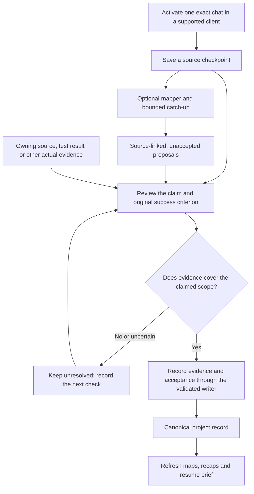
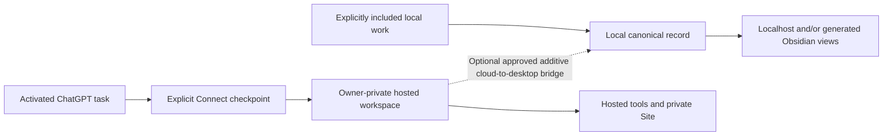

# From a saved chat to verified project progress

Branchi preserves a useful report first. Review turns its supported claims into
project evidence later. This guide illustrates the existing workflow; the
diagrams are explanations, not screenshots or evidence of a live installation.

## The local evidence loop

In words: include a chat, save its report, inspect any proposals, check the
underlying evidence, then update the project record. The automatic reviewer
validates source quotes and writes **unaccepted proposals**; it does not perform
every real-world check or certify the project's original goals.

- **Proposed**: a candidate task, decision or offshoot awaiting review.
- **Reported done**: a completion claim that still needs evidence.
- **Verified complete**: recorded evidence supports completion. When structured
  acceptance criteria and verification stages are present, those gates must also
  be satisfied. A passing test alone does not equal accepted completion.
- **Unknown, blocked and parked** remain distinct. Missing evidence should not
  disappear just because a summary sounds confident.

The saved source preserves provenance. Preserve original requests, manual fields
and earlier decisions when accepting or correcting a proposal. Use the record
editor or revision-checked writer; editing a generated map does not update
project truth.

See [mapper output boundaries](conversation-mapper.md#output-and-evidence),
[bounded catch-up](hourly-review.md#review--validate--update--verify) and the
[manual reconciliation guide](daily-review.md) for the detailed procedures.
The [record model and validation](../skills/brancha/scripts/core.mjs) define the
status and acceptance checks.

## A fictional example: test passed, acceptance still open

Suppose a sample project has this criterion: **“Export a readable report containing
every selected item.”**

| Step | What is known | What to record |
| --- | --- | --- |
| A captured response says “Export is finished.” | A completion report exists. | Keep the source and its claim; do not mark the criterion satisfied. |
| A unit test passes for the item count. | That test covers the count in its fixture. | Record the result and test scope; readability is still unchecked. |
| A reviewer opens the produced report and checks the selected items and layout. | Evidence now addresses the whole example criterion, if those checks pass. | Link the artifact and checks, record acceptance, then update completion. |
| The report is missing a selected item. | Acceptance fails despite the earlier report. | Retain the failed result and a concrete correction/retest step. |

This is an invented walkthrough, not a newly executed test. The same distinction
applies to physical prototypes: a software report cannot establish a physical
measurement that nobody performed.

## Keep Desktop and hosted Connect distinct

Desktop and hosted Connect work independently. The bridge is optional and copies
eligible cloud-origin records into the local record; it is not continuous local
upload or full two-way synchronization. Its current scope is all eligible records
in the connected workspace, not a project allowlist. A one-time seed into an empty
cloud workspace is separate. See [two setups and sync boundaries](two-setups-and-sync.md).

A hosted Site or connected plugin does not passively read every conversation.
Local hooks require the supported runtime, trusted definitions, the companion and
an explicitly activated chat. Local storage also does not mean local-only model
processing when the optional mapper/reviewer is enabled.

## What would prove this setup is working?

| Observation | What it establishes | What still needs checking |
| --- | --- | --- |
| Repository contains the integration | Source availability | Installation, trust and actual runtime delivery |
| Installer or configuration check succeeds | That setup step | A completed event from the intended application |
| Fictional fixture or automated test passes | The exercised code and fixture | Live-client capture and real project acceptance |
| A real activated-client receipt appears | Delivery for that exact client/chat/event | Mapping, review coverage and the claimed outcome |
| Evidence and acceptance are recorded | The checked criterion and scope | Any other criteria, environments or later changes |

For a live delivery check, follow [desktop workflow verification](desktop-workflow.md#know-it-is-working).
Inspect the exact source identity, timestamp and selected project. Inspect a
review receipt separately from a capture receipt; an enabled flag or configured
schedule does not prove either completed. Retain failed or missing coverage
explicitly.

For existing visual examples, see the [0.22 fictional browser captures](release-0.22.md#fictional-browser-checks).
Their captions distinguish shared-renderer fixtures from installed Obsidian and
live hosted workspaces. No live-account capture, desktop upgrade or new runtime
test is claimed by this documentation update.
